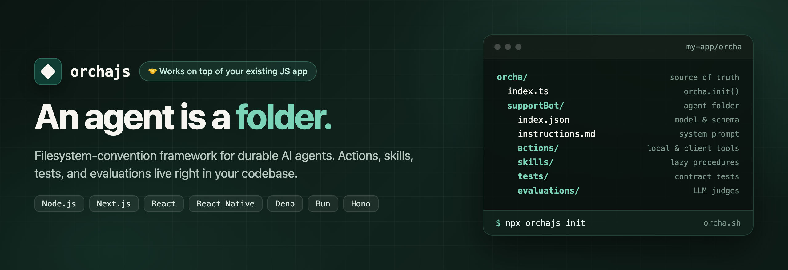

<div align="center">



<br />
<br />

**Build AI agents in JavaScript & TypeScript — right inside your existing app.**  
Works on **Node.js, Next.js, React, React Native, Expo, Hono, Deno, Bun, and Express.** An agent is a folder.

[](https://github.com/Amarsia/orcha)
[](https://github.com/Amarsia/orcha)
[](https://orcha.sh/docs)
[](https://orcha.sh/llms-full.txt)
[](https://www.npmjs.com/package/orchajs)
[](./LICENSE)

<p>
  <a href="https://github.com/Amarsia/orcha"><strong>⭐ Star Amarsia/orcha on GitHub</strong></a> ·
  <a href="https://orcha.sh/docs">Read the Docs</a> ·
  <a href="https://www.npmjs.com/package/orchajs">View on npm</a>
</p>

</div>

---

## Why OrchaJS

Most agent frameworks lock your logic into runtime graphs, proprietary DSLs, or a hosted platform. **OrchaJS is a library, not a platform**—add it to the app you already ship, the way you add Prisma or Zod.

Just like Next.js turns files into routes, **OrchaJS turns folders into durable AI agents**. What you put inside an agent folder—instructions, actions (tools), skills, tests, and evaluations—is automatically discovered, typed, compiled, and persisted.

---

## Get started

### Add to an existing JS/TS project

```bash
npx orchajs init
```

This installs `orchajs` and its compiler tooling (`esbuild`, `chokidar`, `dotenv`, `@orchajs/playground-ui`), creates `orcha/index.ts`, scaffolds `orcha/exampleAgent/`, generates `AGENTS.md`, and updates `.gitignore`. Existing files are never overwritten.

### Or create a new project

```bash
npx create-orcha@latest my-agent-app
cd my-agent-app
npm install
cp .env.example .env
npm run dev
```

### Give your coding agent the Orcha skill

```bash
npx skills add Amarsia/orcha
```

---

## Get started with your framework

Pick your runtime or framework for a complete, copy-pasteable setup guide:

| Framework / Runtime | Guide |
| --- | --- |
| **Node.js** | [Get started with Node.js →](https://orcha.sh/docs/frameworks/node) |
| **React (Vite / Webpack)** | [Get started with React →](https://orcha.sh/docs/frameworks/react) |
| **Next.js (App Router / Turbopack)** | [Get started with Next.js →](https://orcha.sh/docs/frameworks/nextjs) |
| **React Native & Expo** | [Get started with React Native & Expo →](https://orcha.sh/docs/frameworks/react-native) |
| **Deno** | [Get started with Deno →](https://orcha.sh/docs/frameworks/deno) |
| **Bun** | [Get started with Bun →](https://orcha.sh/docs/frameworks/bun) |
| **Hono** | [Get started with Hono →](https://orcha.sh/docs/frameworks/hono) |

---

## The convention

```text
orcha/
  index.ts                      → initializes providers & registers agents
  mcp/
    github/
      index.json                → named MCP server (streamable-http or stdio)
  supportAgent/                 → an agent is a folder
    index.json                  → name, provider, model, limits, output schema
    instructions.md             → required base system prompt (supports {{variables}})
    actions/
      lookupOrder/
        index.json              → tool name, description, JSON schemas, execution
        index.js                → local executable code (omit for execution: "client")
    skills/
      refundPolicy/
        index.json              → lazy-loaded discovery card (name, description, triggers)
        instructions.md         → full procedure loaded on demand via load_skill
    tests/
      delayedOrder/
        index.json              → real-model contract test + mocked action responses
    evaluations/
      responseQuality/
        index.json              → async LLM judge with metrics & thresholds
```

- **Direct child folders** under `actions/`, `skills/`, `tests/`, and `evaluations/` are discovered automatically.
- Set `"enabled": false` in any item's `index.json` to keep WIP work inactive without deleting it.
- Agents and subagents are registered explicitly in `orcha/index.ts`. Registration keys become `orcha.<agentName>`.

---

## Working 1-shot example

Copy these files to build a complete, working tool-calling agent in any Node.js/TypeScript project.

### 1. `orcha/index.ts`

```ts
import { orcha } from "orchajs";

orcha.init({
  providers: {
    anthropic: process.env.ANTHROPIC_API_KEY ?? "",
    // Also supported: openai, deepseek, googlegenai, vertexai, bedrock
  },
  agents: {
    supportAgent: "./supportAgent",
  },
});
```

### 2. `orcha/supportAgent/index.json`

```json
{
  "name": "Support Agent",
  "description": "Help customers check order status using confirmed data.",
  "provider": "anthropic",
  "model": "claude-sonnet-4-6",
  "maxTokens": 4096,
  "outputType": "text"
}
```

### 3. `orcha/supportAgent/instructions.md`

```md
You are a concise customer support assistant.

Always call `lookup_order` before stating an order's status.
Never invent order details or delivery dates.
```

### 4. `orcha/supportAgent/actions/lookupOrder/index.json` & `index.js`

```json
{
  "name": "lookup_order",
  "description": "Look up an order by ID.",
  "parameters": {
    "type": "object",
    "properties": {
      "orderId": { "type": "string" }
    },
    "required": ["orderId"],
    "additionalProperties": false
  },
  "outputSchema": {
    "type": "object",
    "properties": {
      "orderId": { "type": "string" },
      "status": { "type": "string" }
    },
    "required": ["orderId", "status"],
    "additionalProperties": false
  }
}
```

```js
export default async function lookupOrder({ orderId }) {
  return { orderId, status: "in_transit" };
}
```

### 5. `.env`

```bash
ANTHROPIC_API_KEY=your-anthropic-key
```

### 6. `app.ts` (your application entrypoint)

```ts
import "dotenv/config";       // MUST load .env before importing ./orcha/index
import "./orcha/index.js";    // Registers agents onto the shared `orcha` singleton
import { orcha } from "orchajs";

// Start a new durable session
const execution = orcha.supportAgent.run("Where is order ord_1001?");

// Optional: stream cumulative snapshots
for await (const snapshot of execution.stream) {
  if (typeof snapshot.output === "string") {
    process.stdout.write(".");
  }
}

const result = await execution.result;

if (result.status === "completed") {
  console.log("\nAnswer:", result.output);

  // Continue the same durable session later
  const followUp = await orcha.supportAgent.resume(result.sessionId, {
    content: "Summarize that in one sentence.",
  }).result;

  if (followUp.status === "completed") {
    console.log("Follow-up:", followUp.output);
  }
} else if (result.status === "failed") {
  console.error("Run failed:", result.error);
}
```

---

## Common mistakes to avoid (Read before generating code)

1. **Always load `.env` in your app entrypoint.** Standalone CLI commands (`npx orchajs run/test/playground`) load `.env` automatically, **the library does not**. In Node.js apps, import `"dotenv/config"` (or run `node --env-file=.env`) **before** importing `./orcha/index.js`.
2. **Always import `./orcha/index.js` before calling `orcha.<agentName>`.** Import `{ orcha }` from `"orchajs"` and your registry file once at app startup. Never invent path-based calls like `orcha.run("./agent")`.
3. **Ensure compiler devDependencies exist in manual installs.** `npx orchajs init` installs `esbuild`, `chokidar`, and `dotenv` automatically. If you ran `npm install orchajs` manually, also run:
   ```bash
   npm install --save-dev esbuild chokidar dotenv
   ```
4. **CommonJS projects work too:**
   ```js
   require("dotenv").config();
   const { orcha } = require("orchajs");
   require("./orcha");
   ```
5. **Configure your bundler for React / Next.js / React Native / esbuild:**
   - **Next.js (`next.config.ts`)**: `export default async () => withOrcha({});` from `orchajs/next`
   - **React + Vite (`vite.config.ts`)**: `plugins: [orchaVitePlugin(), react()]` from `orchajs/vite`
   - **React + Webpack**: `OrchaWebpackPlugin` from `orchajs/webpack`
   - **Expo (`metro.config.js`)**: `withOrchaExpo(getDefaultConfig(__dirname))` from `orchajs/expo` + `@react-native-async-storage/async-storage`
   - **Bare React Native (`metro.config.js`)**: `withOrchaMetro(getDefaultConfig(__dirname))` from `orchajs/metro` + `@react-native-async-storage/async-storage`
   - **esbuild / Serverless**: `orchaPlugin()` from `orchajs/esbuild`, or `orchajs/serverless` after `serverless-esbuild`
   - **Unbundled `tsc` production builds**: run `npx orchajs build`, ship `.orcha/dist/**`, and set `NODE_ENV=production` or `ORCHA_USE_BUILD=1`.
6. **Respect browser & mobile boundaries:** Browser and React Native builds support `openai`, `anthropic`, `deepseek`, `googlegenai`, and `amarsia.inference: true`. `bedrock`, `vertexai`, `actions.runtime: "sandbox"`, and `stdio` MCP connections are Node.js-only.
7. **Node.js version:** Requires Node.js `>=18.20.8` (`>=20` for `googlegenai` and `vertexai`).
8. **Await `execution.evaluations` in short-lived scripts:** `execution.result` resolves immediately without waiting for async LLM judges; `await execution.evaluations` if your CLI script or job exits right after.

---

## Essential CLI commands

```bash
npx orchajs init                               # Add Orcha to an existing project
npx orchajs dev                                # Validate & watch orcha/** offline
npx orchajs playground                         # Open visual Playground at localhost:4310
npx orchajs run exampleAgent --input "Hello"   # Run an agent from the terminal
npx orchajs test                               # Run all contract tests (and evaluations)
npx orchajs build                              # Compile .orcha/dist/ offline for production
npx orchajs migrate-storage --to sqlite        # Migrate JSONL sessions ↔ SQLite
```

---

## Complete documentation

All documentation is available at **[orcha.sh/docs](https://orcha.sh/docs)** and in LLM-friendly Markdown:

- **LLM Index:** [orcha.sh/llms.txt](https://orcha.sh/llms.txt)
- **Full LLM Reference (single file):** [orcha.sh/llms-full.txt](https://orcha.sh/llms-full.txt)
- **Per-page Markdown:** append `.mdx` to any doc URL (e.g. `https://orcha.sh/docs/actions.mdx`)

### Core guides
- [Getting Started](https://orcha.sh/docs)
- [Create Your First Agent](https://orcha.sh/docs/first-agent)
- [Folder Structure](https://orcha.sh/docs/folder-structure)
- [Agent Configuration & Runtime API](https://orcha.sh/docs/agent)
- [CLI Reference](https://orcha.sh/docs/cli)

### Capabilities
- [Actions (Local, Sandboxed & Client Tools)](https://orcha.sh/docs/actions)
- [Skills (Lazy-Loaded Procedures)](https://orcha.sh/docs/skills)
- [Subagents (Parent-Child Delegation)](https://orcha.sh/docs/subagents)
- [Agent Tests (Deterministic Contract Tests)](https://orcha.sh/docs/tests)
- [Evaluations (Async LLM Judges)](https://orcha.sh/docs/evaluations)
- [Multimodal Input & Tool Results](https://orcha.sh/docs/multimodal)
- [MCP Connections (Streamable HTTP & Stdio)](https://orcha.sh/docs/mcp)

### Tutorials & Complete Examples
- [Basic Agent](https://orcha.sh/docs/tutorial/basic-agent)
- [Agent with Skills](https://orcha.sh/docs/tutorial/skills)
- [Agent that Takes Action](https://orcha.sh/docs/tutorial/actions)
- [Human in the Loop (Client Actions)](https://orcha.sh/docs/tutorial/client-actions)
- [Agent with Subagents](https://orcha.sh/docs/tutorial/subagents)
- [Test an Agent](https://orcha.sh/docs/tutorial/tests)
- [Evaluate an Agent](https://orcha.sh/docs/tutorial/evaluations)
- [Deploy to Production](https://orcha.sh/docs/tutorial/production)

### Durable Sessions API
- [Start a Session (`run`)](https://orcha.sh/docs/sessions/start)
- [Resume a Session (`resume`)](https://orcha.sh/docs/sessions/resume)
- [Get Session Snapshot (`get`)](https://orcha.sh/docs/sessions/get)
- [Read User History (`history`)](https://orcha.sh/docs/sessions/history)
- [List Sessions (`list`)](https://orcha.sh/docs/sessions/list)
- [Update Metadata (`update`)](https://orcha.sh/docs/sessions/update)
- [Pause & Interrupt (`pause`)](https://orcha.sh/docs/sessions/pause)
- [Inspect Raw Events (`events`)](https://orcha.sh/docs/sessions/events)

### Infrastructure, Providers & Amarsia
- [Model Providers (OpenAI, Anthropic, DeepSeek, Gemini, Vertex AI, Bedrock)](https://orcha.sh/docs/model-providers)
- [Storage (JSONL, SQLite, IndexedDB, AsyncStorage, Amarsia Cloud)](https://orcha.sh/docs/storage)
- [Telemetry (Amarsia Analytics & OpenTelemetry GenAI)](https://orcha.sh/docs/telemetry)
- [Orcha Dev Playground](https://orcha.sh/docs/dev-playground)
- [Amarsia Platform & Managed Inference](https://amarsia.com)

---

## License

[MIT](./LICENSE)
